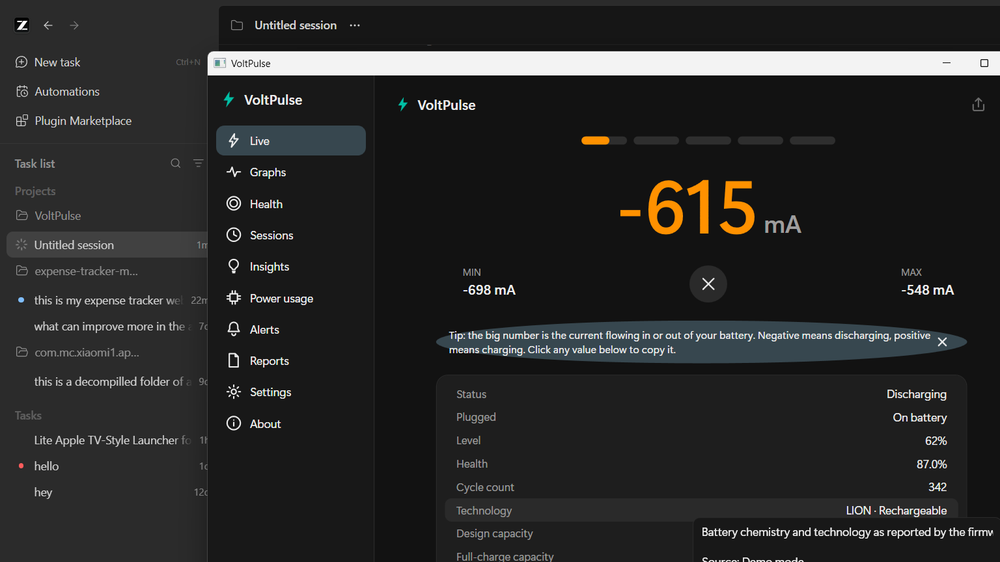

# VoltPulse

[](https://github.com/Shishir-ip/VoltPulse/releases/latest)
[](https://github.com/Shishir-ip/VoltPulse/actions/workflows/build.yml)


A local-only Windows battery monitor for laptops and tablets. It shows live charging/discharging
current (like Ampere on Android), full battery facts, health, history graphs, sessions and smart
alerts - with every value's data source visible. No network access, no telemetry, no accounts, no ads.



## Download

Grab the latest build from the [**Releases page**](https://github.com/Shishir-ip/VoltPulse/releases/latest):

| File | What it is |
| --- | --- |
| `VoltPulse-x.y.z-portable-win-x64.zip` | Portable build - extract anywhere and run `VoltPulse.exe` (recommended) |
| `win-x64/VoltPulse.exe` | Single-file self-contained executable (x64) |
| `win-arm64/VoltPulse.exe` | Single-file self-contained executable (ARM64 laptops) |
| `SHA256SUMS.txt` | SHA-256 checksums - verify before running (builds are unsigned, so SmartScreen shows a one-time warning; see below) |

Every release is built automatically by GitHub Actions from source. No admin rights are required;
nothing is installed unless you use the Inno Setup installer script in `installer/`.

## Features

- **Live screen** - huge animated current reading (mA/A) with state colors (discharging orange,
  charging teal, full green, critical red), 5 level pills, session min/max with reset, and a
  centered fact list. Click any value to copy it; hover for its source and explanation.
- **Layered data providers with fallback** - Windows battery IOCTL (SetupAPI), WMI
  (`root\WMI` + `Win32_Battery`), `GetSystemPowerStatus`, and demo mode. The first provider that
  can answer wins per field; the source is shown in tooltips.
- **Derived values** - current from power (`mA = mW / mV * 1000`), health %, wear, mAh↔mWh,
  time to full/empty from the smoothed rate, %/h, session energy. (Cycle counts come from the firmware when it reports them; no fake estimates.)
- **Graphs** - live chart of current, power, voltage, level and temperature from 1 minute to
  30 days (hourly aggregates for long ranges), pause and PNG export.
- **Health** - health ring, design vs full-charge capacity, wear, cycles, plain-language verdict
  with the exact rule shown, long-term capacity fade from the Windows battery report.
- **Sessions** - charge/discharge episodes with duration, % change, average/peak current and energy.
- **Insights** - charging-habit score (time at 100%, deep discharges, discharge depth) with tips.
- **Alerts** - low/critical battery, charge limit, fully charged, high temperature, high drain,
  health dropped, charger connected/disconnected, slow charging. Cooldowns and 1-hour snooze.
- **System tray** - dynamic icon with level and state colors, live tooltip, full menu.
- **Mini widget** - always-on-top draggable overlay, optional click-through, remembers position.
- **Reports** - history CSV/JSON, full HTML/PDF report (dependency-free PDF writer), powercfg
  battery report import. Serial number is excluded from exports unless you opt in.
- **Settings** - theme (dark/light/follow Windows + automatic high contrast), units, sampling
  interval, smoothing, sign convention, startup options, retention, per-rule alerts, and more.

## Requirements

- Windows 10 (1903+) or Windows 11
- No administrator rights needed
- The published build is self-contained - no .NET installation required

## Build, test, run

```powershell
dotnet build VoltPulse.sln            # build (must be zero warnings)
dotnet test VoltPulse.sln             # run the unit tests (92 tests)
dotnet run --project src\VoltPulse.App   # run from source
```

Diagnostics dump of every raw field from every provider (also written to
`%APPDATA%\VoltPulse\logs\diagnostics.txt`):

```powershell
src\VoltPulse.App\bin\Debug\net8.0-windows\VoltPulse.exe --diagnostics
```

### Release build

`tools\build.ps1` builds, tests, publishes self-contained single-file binaries for **win-x64** and
**win-arm64**, zips the portable build, writes SHA-256 hashes and - if Inno Setup 6 is installed -
compiles `VoltPulse-*-installer.exe`:

```powershell
powershell -NoProfile -ExecutionPolicy Bypass -File tools\build.ps1
```

### Installing and SmartScreen

The binaries are not code-signed (no certificate available), so Windows SmartScreen may show
"Windows protected your PC" on first run. Choose "More info" → "Run anyway", and verify the file
against `dist\SHA256SUMS.txt` first:

```powershell
Get-FileHash .\dist\win-x64\VoltPulse.exe -Algorithm SHA256
```

### Soak test

`tools\soak.ps1` runs the app for a duration and tracks working set/CPU/handles:

```powershell
powershell -NoProfile -ExecutionPolicy Bypass -File tools\soak.ps1 -Hours 24
```

## Architecture

```
src\
  VoltPulse.Core        models (Sourced<T> with provenance), BatteryMath, formatting, interfaces
  VoltPulse.Providers   IoctlBatteryProvider (A), WmiBatteryProvider (B), Win32PowerProvider (C),
                        MockBatteryProvider (demo), AggregatedBatteryProvider (merge), SystemInfoProvider,
                        DiagnosticsDump
  VoltPulse.Services    SamplerService (PeriodicTimer engine), SqliteHistoryStore + HistoryWriterService
                        (batched writes, hourly downsampling, retention), SessionTracker, AlertEngine +
                        AlertEvaluator (pure rules), SettingsService (JSON), PowerCfgReportImporter,
                        ExportService (CSV/JSON/HTML/PDF), InsightsCalculator, PowerUsageScanner,
                        StartupManager, LoggingSetup (Serilog)
  VoltPulse.App         WPF UI: Live/Graphs/Health/Sessions/Insights/Power usage/Alerts/Reports/
                        Settings/About pages, tray icon, toast notifications, mini widget, themes
tests\
  VoltPulse.Tests       xUnit: math, sentinels, smoothing/spikes, merge, sessions, SQLite (incl.
                        corruption recovery), powercfg parser, alerts, insights, exports
```

Data flow: `SamplerService` reads `AggregatedBatteryProvider` every 1 s (adaptive: 5 s when hidden),
then fans out to the Live screen (dispatcher), `HistoryWriterService` (5 s batches to SQLite),
`AlertEngine` (pure `AlertEvaluator`) and the tray/mini-widget. All state changes react instantly to
`SystemEvents.PowerModeChanged` (AC plug/unplug, sleep/resume re-initializes the providers).

## Troubleshooting

| Symptom | Explanation |
| --- | --- |
| "Not supported by this device" for some values | The firmware does not report them. Hover a value to see its source; see LIMITATIONS.md. |
| Current shows "Idle" while plugged in | The driver reports no rate when the battery is full or paused - this is normal. |
| No current at all, but level works | Some OEM drivers only expose level through WMI and no rate when on AC. Unplug the charger to see discharge current. |
| Values differ from `powercfg /batteryreport` | VoltPulse reads the same sources; small timing differences are expected. Capacities match exactly on healthy systems. |
| Alerts did not fire | Check the threshold/enabled state in Alerts, and whether you snoozed for 1 hour. |
| Where is my data? | Everything lives in `%APPDATA%\VoltPulse` (settings.json, data\history.db, logs\, exports\). Deleting the folder is a full reset. |

## Localization

English ships in `src\VoltPulse.App\Resources\Strings.resx`. Add a language by copying it to
`Strings.<code>.resx` (Bengali ships as an example: `Strings.bn.resx`) and translating the values -
no code changes required.

## Privacy

VoltPulse is 100% local.

VoltPulse is 100% local. It never opens a network connection. Diagnostics export is manual (About →
Copy diagnostics) and you can see exactly what it contains before sharing. Serial numbers are
excluded from shared output unless explicitly enabled.

## Why is some data missing on my laptop?

Laptop firmware (EC/SBS) exposes only a subset of battery information, and Windows drivers vary by
vendor. Temperature, cycle count, manufacture date and even precise current are optional. VoltPulse
never invents values: unknown means "Not supported by this device", and estimates are labeled.
See [LIMITATIONS.md](LIMITATIONS.md) for details and [QA.md](QA.md) for the manual test checklist.
